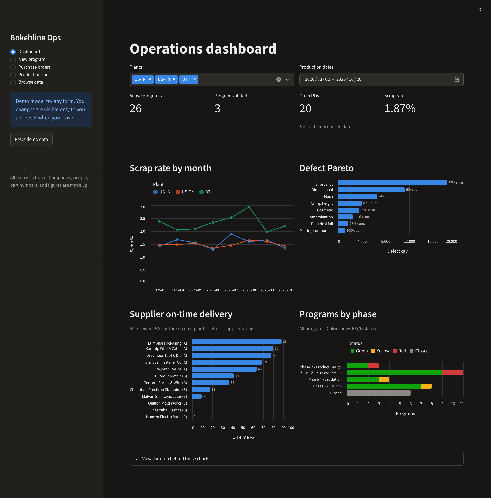

# Bokehline Ops

A plant operations app built with Python, Streamlit, and SQLite. It covers the core loop of a manufacturing program office: launching programs through APQP gates, buying from suppliers, logging production and scrap, and seeing the results on one dashboard.

- **Live demo:** [bokehline-ops.streamlit.app](https://bokehline-ops.streamlit.app)
- **Case study:** coming soon on [bokehline.com](https://bokehline.com)



> **All data is fictional.** Companies, people, part numbers, and figures were generated for demonstration and do not represent any real business.

---

## Features

| Page | What it does | SQL behind it |
|---|---|---|
| **Dashboard** | KPI tiles, scrap rate by plant and month, defect Pareto, supplier on-time delivery, and programs by phase and status. Filter by plant and date range. | `JOIN`, `GROUP BY`, `CASE WHEN`, subqueries |
| **New program** | Creates an APQP program, assigns its code, and plans five gate reviews (G1–G5) evenly between kickoff and start of production. | `INSERT` into two related tables |
| **Purchase orders** | Creates a PO with any number of line items, then receives it and reports on-time or days late. | `INSERT` header and lines, `UPDATE` |
| **Production runs** | Logs a shift's output with a defect breakdown. Scrap is calculated from defects marked *Scrap*. | `INSERT` run and defects |
| **Browse data** | Views and searches any table. | `SELECT` |

## Design decisions

- **Pick, don't type.** Customers, suppliers, parts, plants, and program managers come from dropdowns filled by the database, so there are no misspellings or orphan records.
- **Validation in the forms.** SOP must come after kickoff, a PO needs at least one complete line, and scrap can't exceed quantity produced.
- **Derived, not duplicated.** A run's scrap quantity is calculated from its defect lines instead of entered separately, so the two can never disagree.
- **All-or-nothing saves.** A PO and its lines, or a run and its defects, are written in one transaction. If any part fails, nothing is saved.
- **Friendly locking.** If another tool (such as DB Browser for SQLite) has the database locked, the app explains what to do instead of crashing.
- **Safe public demo.** By default each visitor works on a private copy of the database that resets when they leave (see [Demo mode](#demo-mode-and-working-mode)).

## Data model

Eleven related tables in one SQLite file, modeled on a three-plant manufacturer (Indiana, Tennessee, and Thailand) serving automotive, appliance, small engine, HVAC, consumer electronics, and agriculture customers.

```
customers ──< programs ──< gate_reviews
                 │
                 └──< parts ──< production_runs ──< defects
                                      │
plants ───────────────────────────────┘
suppliers ──< purchase_orders ──< po_lines
employees   (self-referencing manager_id; program managers own programs)
```

| Table | Rows | Holds |
|---|---:|---|
| programs | 32 | APQP phase, R/Y/G status, kickoff and SOP dates, volume, tooling budget |
| gate_reviews | 160 | Planned vs. actual dates; Pass, Conditional, or Fail |
| parts | 89 | Part number, description, unit cost and price |
| purchase_orders | 180 | Supplier, ship-to plant, ordered, promised, and received dates |
| po_lines | 460 | Item, quantity, unit price |
| production_runs | 720 | Part, plant, date, shift, produced, scrapped |
| defects | 1,967 | Defect type, quantity, disposition |
| customers | 19 | Name, segment, country |
| suppliers | 12 | Name, country, commodity, A/B/C rating |
| employees | 60 | Title, department, plant, manager |
| plants | 3 | Code, name, country |

## Sample SQL

**Supplier on-time delivery** (the dashboard's supplier chart):

```sql
SELECT s.name, s.rating, COUNT(*) AS received,
       ROUND(100.0 * SUM(CASE WHEN po.received_date <= po.promised_date
                         THEN 1 ELSE 0 END) / COUNT(*), 1) AS on_time_pct
FROM purchase_orders po
JOIN suppliers s ON s.supplier_id = po.supplier_id
WHERE po.received_date IS NOT NULL
GROUP BY s.supplier_id
ORDER BY on_time_pct DESC;
```

**Scrap audit** (proves every run's scrap equals its Scrap-disposition defects; returns no rows when the data is consistent):

```sql
SELECT r.run_id, r.qty_scrapped,
       COALESCE(SUM(CASE WHEN d.disposition = 'Scrap' THEN d.qty END), 0) AS scrap_from_defects
FROM production_runs r
LEFT JOIN defects d ON d.run_id = r.run_id
GROUP BY r.run_id
HAVING r.qty_scrapped <> scrap_from_defects;
```

**Defect Pareto with cumulative %** (a window function):

```sql
SELECT defect_type, SUM(qty) AS qty,
       ROUND(100.0 * SUM(SUM(qty)) OVER (ORDER BY SUM(qty) DESC)
             / SUM(SUM(qty)) OVER (), 1) AS cumulative_pct
FROM defects
GROUP BY defect_type
ORDER BY qty DESC;
```

`sql/practice-queries.sql` has 32 more queries against this database, from basic `SELECT` through window functions and a recursive org-chart CTE.

## Run it locally

Requires Python 3.10 or newer.

```bash
pip install -r requirements.txt
streamlit run app.py
```

The app opens at http://localhost:8501.

### Demo mode and working mode

- **Demo mode (default).** Each browser session gets a private copy of `bokehline_practice.db`. Forms work normally, but changes are visible only to that visitor and disappear when the session ends. A **Reset demo data** button in the sidebar starts over. The database file in the repository is never modified.
- **Working mode.** Point the app at your own database file and it reads and writes that file directly:

  ```bash
  BOKEHLINE_DB=~/path/to/my_copy.db streamlit run app.py
  ```

Keep personal working databases outside this folder; `.gitignore` blocks every `.db` file except the demo database.

## Project structure

```
bokehline-ops/
├── app.py                   the Streamlit app (all pages)
├── bokehline_practice.db    fictional demo database
├── requirements.txt         Python packages
├── .streamlit/config.toml   theme color
├── screenshots/             images used in this README
├── sql/practice-queries.sql 32 practice queries
├── LICENSE                  MIT
└── README.md
```

## Deploy to Streamlit Community Cloud

The live demo runs at [bokehline-ops.streamlit.app](https://bokehline-ops.streamlit.app). To deploy your own copy:

1. Sign in at [share.streamlit.io](https://share.streamlit.io) with GitHub.
2. Choose **Create app**, select this repository and branch, and set the main file to `app.py`.
3. Deploy. The app runs in demo mode, so visitors can't change the shared data.

Free apps go to sleep after a period without visitors and wake on the next visit.

## Built with

- [Streamlit](https://streamlit.io): web interface
- [SQLite](https://sqlite.org): database
- [pandas](https://pandas.pydata.org): query results as tables
- [Altair](https://altair-viz.github.io): charts

Built while learning SQL, using an AI coding assistant as a tutor and pair programmer.

## License

[MIT](LICENSE) © 2026 Bokehline Technologies LLC
